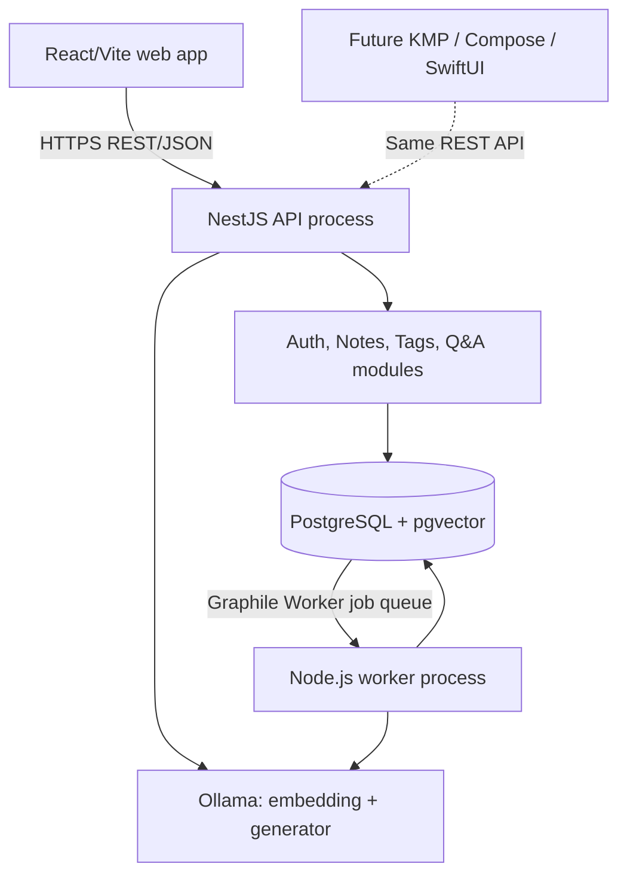
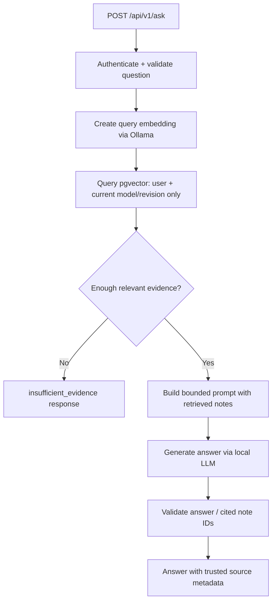

# Personal Knowledge Hub — Architecture

**Status:** Accepted implementation baseline; adjust concrete versions after proof-of-concept and local hardware checks.  
**Scope:** Backend + web CRUD first, then semantic retrieval/RAG; native mobile clients only after backend + web MVP release sign-off.  
**Companion documents:** [Product requirements](./PRODUCT.md) · [Implementation plan](./IMPLEMENTATION_PLAN.md) · [Codex instructions](../AGENTS.md)

## 1. Architectural principles

1. **Modular monolith first.** A single NestJS business codebase provides the API; a separate Node.js worker process handles asynchronous indexing. No distributed microservice boundaries.
2. **PostgreSQL is the source of truth.** Own users, sessions, notes, tags, embeddings, and durable job scheduling in PostgreSQL. pgvector extends it for vector similarity.
3. **Keep user data independent of derived AI data.** Users can save/edit notes even if embedding or generation is unavailable.
4. **Self-hosted open-model inference.** Use Ollama for an embedding model and a separate generative model. Do not require paid LLM APIs.
5. **RAG over search UI.** Semantic retrieval is an internal component of question answering. The MVP exposes **Ask Your Notes**, not keyword search or a separate search page.
6. **One canonical API.** Web and future native clients consume versioned REST/JSON documented with OpenAPI.
7. **Phase separation.** Non-AI note/tag CRUD must be complete in API **and web UI** before indexing or semantic retrieval. Publish a stable web + backend MVP before creating real KMP/Android/iOS applications.
8. **Prefer measured simplicity.** No Redis, external vector database, service mesh, Kubernetes, agent framework, or separate Python service until a concrete requirement appears.

## 2. Technology decisions

| Concern | Baseline | Rationale |
|---|---|---|
| API/backend | NestJS + TypeScript | Familiar language across web/backend, modular DI, REST/OpenAPI support |
| Web | React + Vite + TypeScript | Lightweight SPA, clear separation from backend |
| Mobile (later) | Kotlin Multiplatform + Ktor client, Jetpack Compose for Android, SwiftUI for iOS | Shared networking/domain logic, platform-native UI |
| Data/ORM | PostgreSQL + Drizzle ORM | SQL-visible relational modeling, typed migrations/queries |
| Vector retrieval | pgvector, cosine distance | Store vectors alongside source data and filter by user |
| Durable background jobs | Graphile Worker | PostgreSQL-backed jobs, transactionally enqueued with note writes |
| AI runtime | Ollama | Local HTTP serving for open-weight embedding and generation models |
| Embedding candidate | `nomic-embed-text` | Local text embeddings; evaluate length, prefixes, dimensions, quality |
| Generator candidate | `qwen3:4b` | Local generative answers; confirm inference performance on actual hardware |
| Authentication | Opaque server-side sessions with HttpOnly cookie transport for web | Revocable sessions, no browser-readable bearer token |
| API contract | REST + OpenAPI | Straightforward web and mobile integration |
| Tooling | pnpm workspaces for TS, Gradle/Xcode for mobile, Docker Compose for infrastructure | Independent build ecosystems in one repository |
| Verification | Automated tests + GitHub Actions | Reproducible, reviewer-friendly engineering quality |

Do **not** pin package versions in a design document. Lock actual tested versions in dependency lockfiles; pin model names/versions and verify their checksums/behavior where the runtime supports it. Check licenses of specific redistributed model artifacts before publishing any weights (the repository should not contain model weights).

## 3. Runtime component diagram



**Deployment boundary:** API and worker are independently started processes that share a repository and internal packages. The worker is not a separately owned microservice. Ollama may run on the host or as a container; do not assume that Docker always has GPU access.

## 4. Repository layout

```text
personal-knowledge-hub/
├── AGENTS.md
├── .codex/hooks.json           # Codex agent lifecycle hooks
├── .claude/settings.json       # Claude Code lifecycle hooks
├── .githooks/                 # Git pre-commit / pre-push
├── scripts/                   # Guardrail checks + agent hook handler
├── README.md
├── package.json
├── pnpm-workspace.yaml
├── .env.example
├── .github/workflows/
├── docs/
│   ├── PRODUCT.md
│   ├── ARCHITECTURE.md
│   ├── IMPLEMENTATION_PLAN.md
│   ├── HOOKS.md
│   ├── adr/                    # Add decisions as needed
│   └── evaluation/             # Synthetic RAG evaluation data + reports
├── apps/
│   ├── api/
│   │   └── src/
│   │       ├── indexing/          # AI port, Ollama adapter and worker entry point
│   │       ├── modules/
│   │       │   ├── auth/
│   │       │   ├── users/
│   │       │   ├── notes/
│   │       │   ├── tags/
│   │       │   ├── qa/
│   │       │   ├── retrieval/
│   │       │   └── ai/
│   │       ├── common/
│   │       ├── config/
│   │       └── main.ts
│   ├── web/
│   │   └── src/
│   │       ├── features/{auth,notes,tags,ask}/
│   │       ├── api/
│   │       ├── components/
│   │       └── app/
│   └── mobile/                 # Phase A: README placeholder only
│       ├── README.md          # Deferred native implementation
│       ├── androidApp/        # Future: Milestone 10, Compose
│       ├── iosApp/            # Future: Milestone 11, SwiftUI
│       └── shared/            # Future: Milestone 9, KMP/Ktor
├── packages/
│   ├── database/              # Drizzle schema, client, migrations
│   ├── api-contract/          # Types/schema or generated TS bindings
│   └── shared-config/         # TS, linter config where helpful
└── infra/
    ├── compose.yaml
    └── docker/
```

Mobile subdirectories in this layout are **future targets**, not initial scaffolding. The braces are shorthand for separate directories. Create only the directories needed for the current milestone; **do create `apps/mobile/README.md` at bootstrap** even before a full Gradle/Xcode project exists. `apps/mobile` is not a pnpm workspace package. Avoid a fake, non-buildable KMP scaffold. The existing UI and API must meet Milestone 8 release criteria before real mobile projects begin.

## 5. Backend module ownership

| Module | Owns | Depends on |
|---|---|---|
| `auth` | Registration, password checks, sessions, auth guards, logout | `users`, database |
| `users` | User identity and profile data | database |
| `notes` | Notes CRUD, revisions, transactionally enqueueing indexing | database, queue adapter |
| `tags` | User-owned tags, note associations and filtering | database |
| `retrieval` | Eligible note selection, query embeddings, pgvector ranking | AI embedding provider, database |
| `ai` | Typed ports/adapters for embedding and generation; model health/timeouts | Ollama client |
| `qa` | RAG orchestration, relevance gate, context assembly, answer/source validation | retrieval, AI generation |
| `worker` | Idempotent embedding task and retry/error reporting | database, AI embedding provider |

Keep controllers thin, validate request DTOs, and put business rules in services/use-cases. Internal module interfaces are preferable to direct cross-module table access except when deliberately needed for a transaction.

### AI ports

```ts
interface EmbeddingProvider {
  readonly modelId: string;
  readonly dimensions: number;
  embedDocument(text: string): Promise<number[]>;
  embedQuery(text: string): Promise<number[]>;
}

interface AnswerGenerator {
  readonly modelId: string;
  generateAnswer(input: {
    question: string;
    sources: Array<{ noteId: string; title: string; content: string }>;
  }): Promise<string>;
}
```

An adapter should implement appropriate **document vs. query input formatting** for the chosen embedding model. No general-purpose LLM orchestration framework is necessary.

## 6. Data model (logical schema)

Use UUID identifiers (or another documented, consistently used collision-resistant identifier), `timestamptz` timestamps, foreign keys, and explicit delete behavior. Exact SQL/Drizzle syntax belongs in migrations, not this document.

| Table | Core columns | Constraints / notes |
|---|---|---|
| `users` | `id`, `email`, `password_hash`, `created_at`, `updated_at` | Email unique after canonical normalization; Argon2id password hash |
| `sessions` | `id`, `user_id`, `token_hash`, `created_at`, `expires_at`, `revoked_at` | Token hash unique; FK to users; expire/revoke on logout |
| `notes` | `id`, `user_id`, `title`, `body`, `content_revision`, `indexing_status`, `indexing_model`, `indexing_request`, `created_at`, `updated_at` | FK to users; revision starts at 1, increases only for title/body edits; check status/revision validity |
| `tags` | `id`, `user_id`, `name`, `normalized_name`, `created_at` | Unique (`user_id`, `normalized_name`) |
| `note_tags` | `user_id`, `note_id`, `tag_id` | Composite PK/unique; enforce both note/tag ownership, preferably with composite FKs including `user_id` |
| `note_embeddings` | `note_id`, `content_revision`, `model_id`, `embedding`, `created_at` | One current embedding per note; `note_id` PK and cascading FK; `vector(768)` for the initial `nomic-embed-text` candidate |

Graphile Worker creates and maintains its own schema. Do not duplicate its queue tables in Drizzle's application schema.

### Indexes

- `users`: normalized unique email.
- `sessions`: unique `token_hash`, indexes supporting lookups and expiration cleanup.
- `notes`: `(user_id, updated_at DESC, id)` for owner-scoped pagination.
- `tags`: `(user_id, normalized_name)` unique.
- `note_tags`: keys/FKs and reverse lookup by tag.
- `note_embeddings`: PK on `note_id`; initially **exact cosine nearest-neighbor retrieval**. No HNSW index until benchmarks justify it.

A typical retrieval query joins `note_embeddings` to `notes`, filters `notes.user_id = authenticatedUserId`, `notes.indexing_status = 'ready'`, `note_embeddings.content_revision = notes.content_revision`, and `note_embeddings.model_id = configuredEmbeddingModel`, then orders by cosine distance. Bound `topK` to a small server-owned value (initially 3–5). Never retrieve across users and filter in application memory.

### Revision / status invariant

- `notes.content_revision` is the authoritative content version.
- `note_embeddings.content_revision` identifies the exact note text embedded.
- A note is **ready** only if a current-model embedding exists for its current revision.
- `indexing_status` is a user-facing operational projection (`pending`, `ready`, `failed`); keep it synchronized transactionally. Stale-job failures must not overwrite newer revision statuses.
- A deleted note cannot be resurrected by an in-flight worker.

## 7. Note write and indexing design

### Pre-indexing behavior (Milestones 3–4)

Note and tag CRUD is complete *before* a working job handler and model exist. Note saves remain durable, bump content revision when content changes, and return a truthful **not yet indexed / pending** state. Do **not** pretend a Graphile job was enqueued before the transactional integration is wired. The indexing worker backfills existing notes on startup. New writes enqueue atomically even while the worker is offline. The final behavior below applies once indexing is enabled.

```mermaid
sequenceDiagram
  participant C as Web/Mobile
  participant A as NestJS
  participant P as PostgreSQL
  participant W as Worker
  participant O as Ollama
  C->>A: POST /notes or PATCH /notes/:id
  A->>P: BEGIN; write note/revision; add_job SQL
  P-->>A: COMMIT
  A-->>C: Saved note (indexing: pending)
  W->>P: Claim durable job and read note
  W->>O: Embed title + body
  O-->>W: Vector
  W->>P: Conditional update if revision still current
  P-->>W: Applied or stale/deleted (no-op)
```

1. Within **one PostgreSQL transaction**, create/update the note and call Graphile Worker's `graphile_worker.add_job(...)` SQL function; do not save note and enqueue on separate uncoordinated connections.
2. On note updates, enqueue only when the title or body changes. Backfill and explicit reindex requests can also enqueue work. Avoid duplicate work where practical, but assume jobs are delivered **at least once**.
3. Worker loads fresh note state and exits cleanly if deleted or revision superseded.
4. Call Ollama outside a database transaction; never hold a row lock while waiting for model inference.
5. On completion, perform a conditional database transaction that upserts embedding **only when the owner, note revision, model ID and indexing request ID match the job**, and sets status `ready` atomically.
6. On transient model/DB failure, let Graphile Worker retry with bounded attempts/backoff. On terminal failure, mark the **matching revision** failed (without changing a newer revision's status) and provide an explicit reindex/recovery path.
7. Ensure old embeddings never qualify as current evidence; deletion must cascade embeddings. Reindex all notes if the embedding model/dimension changes.

Do not publish sensitive note text in queue payloads or verbose logs. Use `{ noteId, userId, contentRevision, modelId, requestId }` and read note content in the worker.

## 8. Question answering (RAG) design



- One independent question per request. No conversation storage or streaming in the MVP.
- Embed the query with the **same embedding model family** used to index notes, applying query-specific formatting where needed.
- Retrieve up to `topK` ready, user-owned notes using cosine distance; measure/calibrate an evidence threshold with synthetic evaluation data. A nearest neighbor alone is not proof of relevance.
- Use a bounded prompt/context budget and note size cap; one embedding per note, no chunking for MVP.
- Tell the generator to answer only from provided notes and acknowledge missing evidence. Treat notes as **untrusted data**, not instructions.
- Give the generator up to three note titles and the first 1,000 code points of each body. Ask for structured verbatim excerpts paired with canonical note IDs. Verify each excerpt against the supplied text, recheck all supplied note revisions and indexing requests after inference, and derive the plain-text answer and source metadata on the backend. Evaluate whether the selected excerpts actually address the question.
- If the model fails/overruns its timeout, return a distinct, retryable `AI_UNAVAILABLE` / `AI_TIMEOUT` error; do not conflate this with `insufficient_evidence`.
- Implement retrieval and answer generation with interfaces and mocks; a real-model evaluation suite is a separate, opt-in test task.

## 9. API conventions

Use prefix `/api/v1`, JSON DTOs, standardized error codes, input validation, a documented pagination strategy, and OpenAPI generated from the application. Client contracts must not expose session token hashes or raw model vectors.

The [HTTPS v1 OpenAPI baseline](api/v1.openapi.json) is verified against the running API. Review compatible updates to the snapshot alongside implementation changes. Breaking changes require a versioning decision. [ADR-009](adr/009-native-session-transport.md) records the native transport proposal and the checks deferred to Milestone 9.

| Method | Path | Purpose |
|---|---|---|
| POST | `/auth/register` | Create account |
| POST | `/auth/login` | Create session, set cookie |
| POST | `/auth/logout` | Revoke session |
| GET | `/auth/me` | Current account |
| GET | `/notes` | Owner-scoped, paginated notes; optional tag filter |
| POST | `/notes` | Create note; enqueue indexing atomically |
| GET | `/notes/:id` | Read owned note |
| PATCH | `/notes/:id` | Edit owned note; enqueue only if content changed |
| DELETE | `/notes/:id` | Delete owned note |
| POST | `/notes/:id/reindex` | Queue indexing for an owned note without editing it |
| GET | `/tags` | Owner's tags |
| POST | `/tags` | Create tag |
| PATCH | `/tags/:id` | Rename owned tag |
| DELETE | `/tags/:id` | Delete owned tag |
| PUT | `/notes/:id/tags` | Replace associated tag IDs atomically |
| POST | `/ask` | One-shot answer from user's indexed notes |

All paths in table are relative to `/api/v1`.

Note responses include the assigned `tagIds`. `GET /notes` accepts an optional `tagId` UUID and applies that filter before offset pagination. An unavailable tag produces an empty page. `PUT /notes/:id/tags` accepts `{ "tagIds": [...] }`, returns HTTP 204, and rejects an unavailable note or tag with HTTP 404 before changing assignments. It locks the note and validates the requested tags in the same transaction as the replacement. Tag changes leave the note’s content revision and timestamps intact.

Tag names preserve the trimmed display spelling. The uniqueness key uses NFC normalization and lowercase and is scoped to the owner. Tag creation and rename return HTTP 409 with `TAG_NAME_IN_USE` on a duplicate.

**Example** `POST /api/v1/ask`:

```json
{ "question": "What did I learn about structured concurrency?" }
```

**Example success** (illustrative). The answer consists of the validated excerpts in order.

```json
{
  "status": "answered",
  "answer": "Child coroutines run within the lifetime of their parent scope.",
  "sources": [
    { "noteId": "<uuid>", "title": "Coroutines and scopes", "excerpt": "Child coroutines run within the lifetime of their parent scope." }
  ]
}
```

**Example insufficient evidence:**

```json
{ "status": "insufficient_evidence", "answer": null, "sources": [] }
```

Define and validate a shared error schema for `401`, `403/404`, `409`, `422`, `429`, and `503` as appropriate. Do not promise that every model reply is accurate merely because it returns sources.

## 10. Authentication and security

- Register/login with email + password; hash passwords with **Argon2id** using a maintained implementation.
- Generate high-entropy opaque session tokens. Store **hashes** server-side, not plaintext tokens. Support expiry, logout revocation, and cleanup.
- For the web, set session cookie `HttpOnly`, `Secure` in HTTPS environments, with deliberate `SameSite`, `Path`, and optional domain settings. Design browser API deployment to avoid unnecessary cross-site cookies.
- Protect state-changing cookie-authenticated routes against **CSRF** (e.g. verified Origin and an appropriate CSRF token strategy). Configure credentialed CORS narrowly; no wildcard origins with credentials.
- After the web MVP release gate, KMP clients may use Ktor cookie support with platform-backed persistent credential storage (Android Keystore-based strategy / iOS Keychain). Verify refresh/expiry/logout, CSRF/Origin behavior and platform-specific cookie handling against the actual API before deciding on any alternative transport; document major changes in an ADR and regress web auth. **HttpOnly is a browser cookie property, not a substitute for secure native storage.** Reassess mobile auth ergonomics in the mobile milestone; do not prematurely introduce JWT.
- Enforce ownership for reads/writes, tag assignment, retrieval, and cited sources, preferably in SQL predicates/FKs. Write explicit cross-user access tests.
- Restrict note/question size, rate-limit login and Q&A, set generation timeouts/concurrency limits, redact credentials and note contents from logs, keep Ollama and PostgreSQL off public networks unless secured.
- Do not allow text from notes to control model/system instructions, execute actions, or change user identity.

## 11. Local environment and operations

- Docker Compose starts PostgreSQL with pgvector and supports API/worker, with a configurable Ollama base URL. Ollama can be containerized when viable or run on the host for reliable GPU acceleration.
- Configure environment from `.env.example`: database URL, server port, allowed web origin, session settings, Ollama URL, embedding/generation model IDs, model dimensions, job settings, timeouts. No real secrets in git.
- Document how to install/pull both models and verify model readiness. Model downloads may require internet once; inference should remain local thereafter.
- Apply Drizzle migrations before running API/worker; initialize the Graphile Worker schema with its supported migration/setup mechanism.
- Provide useful health checks: database connectivity, API readiness, and separately observable Ollama/worker health. Report AI degradation without misreporting the entire API as unusable.
- Emit structured logs with request IDs, error codes, indexing outcomes and durations. Log question/notes **only if explicitly enabled for debugging with safe data**.
- Keep resource needs and memory/CPU/GPU limitations visible in README; an always-on public demo is optional, not required for MVP.

## 12. Testing and evaluation strategy

1. **Unit:** domain validation, ownership guards, auth services, context builder, relevance decision, output/source validation, idempotency helpers.
2. **Database integration (real PostgreSQL + pgvector):** migrations, FK constraints, owner-scoped queries, Drizzle operations, nearest-neighbor ordering, transactional job enqueue.
3. **API E2E:** register/login/logout, cookie/CSRF handling, note/tag CRUD, Ask endpoint with fake deterministic providers, cross-user isolation.
4. **Worker integration:** retries, stale revision race, duplicate job delivery, deletes during processing, model outage, recovery.
5. **Optional live-model evaluation:** seeded synthetic notes, 20–30 questions, expected source notes, retrieval Recall@K, abstention, groundedness/citation validity, latency by stage. Keep this out of default CI unless suitable model capacity is available.
6. **Web UI:** notes/tags CRUD E2E first (with Ollama offline), then Ask/source-navigation E2E; empty/error states throughout.
7. **Mobile (post-MVP):** OpenAPI/KMP contract parity, secure native sessions and lifecycle, Android/iOS build/UI smoke, note/tag/Ask flows; iOS verification requires macOS/Xcode.

Do not claim benchmark gains or production readiness without the corresponding measurements and tests.

## 13. Architecture decision register

| ID | Decision | Explicit trade-off |
|---|---|---|
| ADR-001 | Modular monolith + standalone worker process | Simple operations; not independently deployed business services |
| ADR-002 | PostgreSQL + Drizzle + pgvector | One database, typed SQL; no specialized vector database |
| ADR-003 | Graphile Worker, no Redis | Transactional queue; defer Redis caching/BullMQ experiments |
| ADR-004 | Ollama with open-weight model candidates | Local privacy/control; compute and model-quality constraints |
| ADR-005 | Semantic retrieval internal to one-shot RAG | Better demo of AI pipeline; no exact-term search UX |
| ADR-006 | Opaque cookie-backed web sessions | Revocable server sessions; CSRF/native credential persistence considerations |
| ADR-007 | One embedding per bounded note; exact search first | Simple baseline; long notes/chunking/HNSW deferred |
| ADR-008 | Mobile placeholder now, actual KMP/Compose/SwiftUI only after web+API release | Stable API and vertical slices first; dedicated native milestones |

Create separate ADR files if a decision is materially revised. Update these documents when product scope or approved architecture changes.

## 14. Delivery sequence and enforceable controls

The [implementation plan](./IMPLEMENTATION_PLAN.md) orders **API CRUD → web CRUD → indexing → retrieval/Q&A API → Ask web UI → backend+web release → KMP → Android/iOS → mobile release**. Keeping `apps/mobile/README.md` early is a repository convention, *not* permission to start mobile coding. KMP shares typed Kotlin networking/domain code only; web TypeScript types are aligned via OpenAPI, not imported into Kotlin. Design the initial API so both platforms can consume it, but avoid adding a new auth framework prematurely.

Automated controls are implemented as actual scripts and lifecycle/Git/CI hooks, documented in [HOOKS.md](./HOOKS.md). They catch certain changes before tools run or before commits/merges; the security invariants here are validated by API/database/worker tests. Hooks are bypassable or fallible; only required CI checks with protected branches form a merge gate, and human review remains essential for design changes.

## 15. Upstream documentation

- [Graphile Worker — enqueue with SQL](https://worker.graphile.org/docs/sql-add-job)
- [Graphile Worker — guarantees and behavior](https://worker.graphile.org/docs)
- [Drizzle — PostgreSQL extensions / vector search](https://orm.drizzle.team/docs/extensions)
- [Ollama — embeddings](https://docs.ollama.com/capabilities/embeddings)
- [Ollama — API](https://docs.ollama.com/api)
- [Ktor — client cookies](https://ktor.io/docs/client-cookies.html)

These are guidance/reference links, not guarantees that an unpinned package version behaves identically. Verify behavior against installed versions during implementation.
