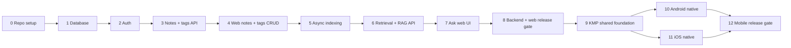

# Personal Knowledge Hub — Incremental Implementation Plan

**Purpose:** Deliver small, tested vertical slices with a working non-AI notes product before semantic search.  
**Authority:** [PRODUCT.md](./PRODUCT.md) defines behavior; [ARCHITECTURE.md](./ARCHITECTURE.md) defines design; [AGENTS.md](../AGENTS.md) provides the agent workflow; [HOOKS.md](./HOOKS.md) documents executable checks.

## Delivery order and dependencies

**Hard order:** Milestones **0–4 = independently usable note CRUD**, with no Ollama dependency. **No semantic retrieval, RAG endpoint, or Ask UI before Milestone 4 exits.** Indexing is a later enhancement; **no real native mobile implementation before Milestone 8 exits**. Android and iOS development can proceed in parallel after the shared KMP foundation is verified. Do not mistake a responsive web app for a native mobile release.

Work one milestone or coherent sub-step at a time. A milestone is complete only when its exit criteria and tests have been **run and recorded**, not when files merely exist. Record command results in the PR/task report, and keep root scripts/CI accurate. Use [automated checks](./HOOKS.md) alongside behavioral tests; no hook can prove user isolation or AI groundedness from source-text matching alone.

**Suggested agent prompt:** “Read AGENTS.md and the owning docs, inspect code, implement only Milestone N / Step X, and report files changed, real checks run, blockers and next step.”

## Phase A — Usable notes product (before AI)

### Milestone 0 — Monorepo, hooks, and reproducible tooling

**Goal:** A clean checkout can run the minimum API/web scaffold and database.

- [x] Create pnpm workspace with a tested pinned `packageManager` value, buildable NestJS API and React/Vite app, shared configuration only when used, and runnable worker entrypoint once needed.
- [x] Provide PostgreSQL + pgvector through Docker Compose, env example, migration/setup instructions, root README, and basic health endpoint.
- [x] Create **only** `apps/mobile/README.md` describing the deferred KMP, Compose and SwiftUI modules; no fake native project.
- [x] Wire tested root scripts (`lint`, `typecheck`, `test`, `test:integration`, `build`) and extend CI to run them against real PostgreSQL/pgvector; ensure synthetic fixtures and deterministic fake AI providers.
- [ ] Activate and verify [agent/Git hooks](./HOOKS.md), configure protected branches/required checks, and document developer setup.

**Tests:** Clean install/start, Postgres/pgvector smoke, API health, Git hook failure/success, CI run.

**Exit:** Reproducible scaffold and enforced CI, with no private data committed; native folder is a placeholder only.

**Verification (2026-11-21):** The frozen install, lint, typecheck, hook tests, API health test, pgvector smoke and build passed via `node scripts/verify.mjs ci`. Git uses `.githooks` locally. The [hosted Guardrails run](https://github.com/zaferertas/knowledge-manager/actions/runs/44921080300) passed on the scaffold commit. Milestone 0 remains open because GitHub reports `main` as unprotected and the `guardrails` check is not required. Agent hook activation in the host still needs confirmation.

### Milestone 1 — Relational database foundation

**Goal:** Reproducible schema for users, sessions, notes and tags; embedding tables can be created now but are not active.

- [ ] Implement Drizzle migrations for `users`, `sessions`, `notes`, `tags`, `note_tags`, `note_embeddings`; define keys, ownership constraints, timestamps, revisions and deletion cascades as in Architecture.
- [x] Add owner-scoped pagination/indexes, tag uniqueness and composite note/tag ownership constraints.
- [x] Initialize Graphile Worker schema using its supported migration mechanism; job execution is introduced in Milestone 5.
- [ ] Add synthetic seed data and migration instructions. Never rewrite an already-applied migration; add a successor.

**Tests:** Empty-DB migration; uniqueness, FK/cascade and ownership constraint tests; pgvector insert/read on real Postgres.

**Exit:** Schema reconstructs from scratch and constraints reject cross-user associations.

**Progress (2026-11-21):** The first Drizzle migration creates users, sessions, notes, tags and note associations. `pnpm test:integration` applied it twice to a fresh PostgreSQL database and verified uniqueness, both ownership foreign keys and deletion cascades. The same command initialized the Graphile Worker schema and verified that its public SQL API can enqueue a synthetic job. The embedding table and reusable seed are pending.

### Milestone 2 — Authentication and authorization

**Goal:** Requests identify the correct account securely.

- [ ] Add registration/login/logout/`/auth/me`, Argon2id, opaque revocable hashed-at-rest sessions and expiry.
- [ ] Implement web cookie/Origin/CSRF/CORS policy, request principal, owner-aware guards and rate limits.
- [ ] Document browser deployment origins and error contracts through OpenAPI.

**Tests:** Login/logout/expiry, invalid login, cookie flags, CSRF rejection, protected routes, two-user isolation.

**Exit:** Auth works independently of AI; unauthorized and cross-user requests fail safely.

### Milestone 3 — Notes and tags REST API (CRUD first)

**Goal:** All non-AI domain operations work end-to-end against the backend.

- [ ] Implement owner-scoped notes create/list/read/update/delete, input bounds, timestamps and pagination.
- [ ] Implement tags CRUD, normalized unique names, note-tag replacement/assignment and tag-filtered list.
- [ ] Update `content_revision` only when title/body changes; ensure delete cascades. Before indexing exists, expose a truthful `pending` / **not yet indexed** state, not a claim that a queue job has run.
- [ ] Generate OpenAPI schemas, stable error responses and DTO validation; ensure an AI outage never blocks note persistence.

**Tests:** All CRUD cases, validation boundaries, page ordering, unchanged updates, cross-user guessed IDs, association ownership and cascades.

**Exit:** Documented non-AI API fully usable without Ollama or a live embedding worker.

### Milestone 4 — Web notes-and-tags vertical slice (usable product checkpoint)

**Goal:** A user can register and **create, read, update, delete and organize notes in the browser** before any semantic-search implementation.

- [ ] Build typed API client, CSRF-aware cookies and session-expiry behavior.
- [ ] Build auth screens, note list/detail/editor/deletion, timestamps, empty/validation/network states and tags CRUD/assignment/filter.
- [ ] Show indexing as **not yet available / pending** until Milestone 5 supplies the worker; do not show fake progress or an Ask control that does nothing.
- [ ] Add accessible, keyboard-friendly, responsive layout and web UI tests for full CRUD.
- [ ] Confirm notes remain editable when Ollama is absent.

**Tests:** Browser E2E register → create → read → edit → tag/filter → delete → log out; two-user access denial in API suite; Ollama-off smoke.

**Exit (mandatory before AI work):** Real end-to-end **web + backend note/tag CRUD** is demoable and tested, with no vector-search or model dependence.

## Phase B — AI as an additive capability

### Milestone 5 — Durable note indexing (no search UI)

**Goal:** Index persisted notes in the background without changing CRUD behavior.

- [ ] Implement `EmbeddingProvider` port, Ollama adapter, model/dimension configuration and document/query input formatting.
- [ ] Transactionally enqueue `index-note` through Graphile Worker SQL with note creation/content edits; include a migration/backfill path for notes created in Phase A.
- [ ] Make handler idempotent; never keep a DB transaction open over model inference; verify current revision/model before publishing vectors or statuses.
- [ ] Handle failed/retried/stale/deleted jobs, AI outage, terminal failures and explicit reindex/retry UX.
- [ ] Keep user-owned note data available and changes durable when Ollama is down.

**Tests:** Real PG transactional enqueue, duplicate/stale jobs, deletion race, outage/retry/recovery, model dimension mismatch and Phase-A backfill.

**Exit:** Only current owner-approved note revisions are indexed; CRUD remains available on AI failure. No query-answering feature yet.

### Milestone 6 — Internal retrieval and one-shot RAG API

**Goal:** Securely answer from indexed notes via `POST /api/v1/ask`, without a standalone search page.

- [ ] Implement owner-filtered exact cosine retrieval of **ready/current-revision/current-model** embeddings, bounded `topK` and calibrated relevance threshold.
- [ ] Add Ollama answer generation, bounded untrusted-note context, evidence gating and prompt-injection resilience.
- [ ] Return backend-authorized source metadata; validate generated citations; distinguish insufficient evidence from AI timeout/unavailable.
- [ ] Document API contract and deterministic fake-model tests; run separate opt-in live-model evaluation.

**Tests:** Answerable/unanswerable questions, zero/pending notes, multi-user isolation, stale revisions, fake citations, malicious note text, timeout/unavailable.

**Exit:** API returns supported answers with valid citations or explicit abstention; no separate keyword/semantic results page or persisted chat.

### Milestone 7 — Add Ask Your Notes to web

**Goal:** Complete the one-shot AI experience without regressing note CRUD.

- [ ] Add question form, loading, supported answer, source links to note detail, abstention and recoverable error states.
- [ ] Display indexing ready/failed/pending states accurately; make reindex/retry discoverable.
- [ ] Keep the editor plain text; do not introduce conversations, keyword search, Markdown editing or chat persistence.

**Tests:** Browser E2E create note → indexing → ask → open source; insufficient evidence; model-off; regression tests for CRUD/tags.

**Exit:** All approved web user journeys work with the same backend APIs.

### Milestone 8 — Backend + web MVP release gate (mobile dependency)

**Goal:** Establish a stable, tested and documented API/web baseline *before any native-client implementation*.

- [ ] CI runs install, build, lint, typecheck, unit, real PG integration, API E2E and web E2E; fake AI default, live Ollama optional.
- [ ] Verify OpenAPI schema, auth cookie/CSRF integration, migrations, worker races, cross-user denial and CRUD-to-RAG regression.
- [ ] Build synthetic RAG evaluation set (roughly 20–30 questions), record retrieval/source validity, abstention/groundedness and latency evidence; document hardware limitations.
- [ ] Complete README (environment, migrations, model setup, troubleshooting), health/observability, redacted logs, security/licensing review and fresh-clone smoke.
- [ ] Freeze/version the `/api/v1` contract for mobile consumption; capture outstanding design decisions as ADRs, especially native-session transport.
- [ ] Record an explicit **human-reviewed web MVP release decision** and remaining limitations in `docs/releases/web-mvp.json` (approval, CI run, web CRUD E2E, API security and OpenAPI evidence); this file is a required CI/Git gate before adding real `apps/mobile/` code. Only then schedule Milestones 9–12.

**Tests:** Full CI + clean-room run + contract/evaluation evidence, independently repeatable by a reviewer.

**Exit (hard mobile gate):** Stable backend **and** usable, release-ready web app are both verified; API is documented, security-critical tests pass, and the release decision is recorded.

## Phase C — Native clients, only after Phase B release

### Milestone 9 — KMP shared foundation and API parity

**Depends on:** Milestone 8 signed off. **Goal:** Shared Kotlin networking/domain foundation that consumes the existing backend without widening MVP scope.

- [ ] Replace `apps/mobile/README.md` placeholder with a real buildable Gradle KMP `shared` module plus minimal Android Studio/Xcode integration, no TypeScript imports.
- [ ] Define shared DTOs/domain/repository interfaces, Ktor transport, error mapping, pagination, retries/timeouts and contract compatibility from a versioned OpenAPI spec (generated or tested against it).
- [ ] Choose and document native auth strategy against cookie-backed sessions: secure Android/iOS credential persistence, CSRF/origin handling, expiry/revocation, logout and no browser `HttpOnly` assumptions. Seek an ADR if API changes are necessary.
- [ ] Use platform abstractions for Keystore/Keychain-backed session persistence; never commit tokens or note bodies to logs. Keep first release online-only, with no offline sync.

**Tests:** KMP common unit/contract tests, fake API, real API auth/CRUD smoke on appropriate targets, secure-storage interface tests.

**Exit:** Buildable shared module and verified session + note API parity on Android/iOS targets; any cross-platform API change covered by web regressions.

### Milestone 10 — Android native app (Jetpack Compose)

**Depends on:** Milestone 9. **Goal:** Android can complete every approved core journey.

- [ ] Implement Compose navigation, login/register/logout and secure session lifecycle.
- [ ] Build note list/detail/create/edit/delete; tags CRUD/assignment/filter; indexing status and retry behavior.
- [ ] Add one-shot Ask UI, loading/errors/abstention, source-note navigation, accessible labels and rotation/lifecycle recovery.
- [ ] Document emulator/device configuration, local backend connectivity and release build steps.

**Tests:** Android instrumented UI smoke + KMP tests; API integration for auth, CRUD/tag, RAG sources and user isolation.

**Exit:** Android app runs against existing `/api/v1`, preserves private credentials securely, and passes core journeys without new backend feature work.

### Milestone 11 — iOS native app (SwiftUI)

**Depends on:** Milestone 9; may run alongside Android. **Goal:** iOS matches the same product capabilities with its own UI.

- [ ] Integrate shared KMP framework into Xcode project; implement native SwiftUI screens/navigation.
- [ ] Implement registration/session lifecycle with Keychain-backed storage; note/tag CRUD/filter and indexing states.
- [ ] Add one-shot Ask view, error/abstention states and navigation to authorized cited notes; handle iOS app lifecycle and network interruptions.
- [ ] Document simulator/device setup and signing/release dependencies without checking in secrets.

**Tests:** iOS simulator UI smoke, common KMP tests, secure storage/expiry tests and contract tests against the same API.

**Exit:** iOS client completes the same core journeys against `/api/v1`; requires macOS/Xcode for an actual verified build (record limitations honestly otherwise).

### Milestone 12 — Mobile parity, security and release gate

**Depends on:** Milestones 10 and 11. **Goal:** Ship reproducible native clients without destabilizing the web app.

- [ ] Verify contract parity across web, Android and iOS; no undocumented endpoints or divergent semantics.
- [ ] Run real-device/simulator auth and storage checks, reconnect/error paths, source links, accessibility, and no cross-user leakage.
- [ ] Verify Android/iOS builds, lock dependencies, document signing distribution and privacy behavior, and configure platform CI runners where available.
- [ ] Re-run backend/web regression gates after any mobile-driven API changes; record release evidence and remaining risks.

**Tests:** Both native UI smoke suites + KMP shared tests + API/web regression + secure-session tests.

**Exit:** Android and iOS builds and release evidence exist; both deliver notes/tags/Ask parity without offline sync, rich text or unrelated features.

## Tracking and cross-cutting quality

For every milestone, record tests **actually executed**, their results, unresolved risks and the next task. Check boxes only after verification. Every behavior change needs corresponding tests; use a real PostgreSQL/pgvector instance for DB integration and deterministic fake AI providers in standard CI. OpenAPI changes require client/contract updates. Never publish secrets or private note data.

Automated pre-tool, post-tool, commit, push and CI checks are defined in [HOOKS.md](./HOOKS.md). Security invariants that require execution—ownership in SQL, CSRF, revision races, source allowlisting—are enforced with the milestone-specific tests above, not regex-based claims. Human approval is still required for material stack/scope, auth-protocol or model-dimension changes, destructive schema actions, and release sign-off.
